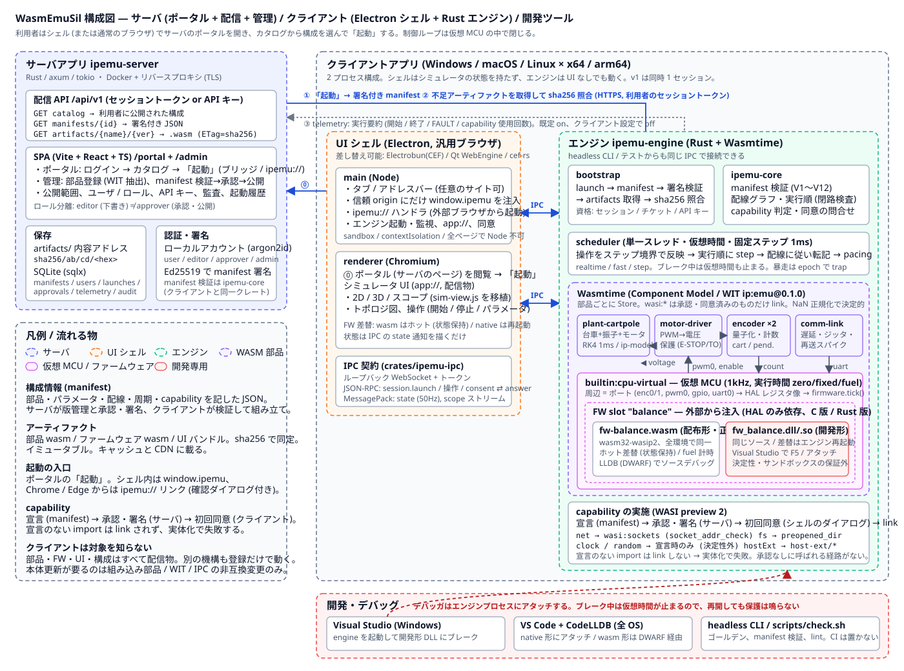

# 02. アーキテクチャ

## 全体像


2 つのアプリと、その間を流れる 3 種類の物 (構成情報・アーティファクト・テレメトリ) で構成します。
クライアントは **UI シェル (Electron)** と **エンジン (Rust + Wasmtime)** の 2 プロセスです。

利用者から見た流れは「シェル (普通のブラウザ) でサーバの**ポータル**を開き、ログインし、カタログから構成を選んで**起動**を押す」です。
起動ボタンはシェル内では特権ブリッジ (`window.ipemu`) を、Chrome / Edge では `ipemu://` リンクを呼び、
どちらもローカルのエンジンに「この構成を組み立てて動かせ」と伝えます。

```text
┌─ サーバアプリ ipemu-server (Rust / axum) ─────────────────────────────────────┐
│  配信 API (/api/v1)                        SPA (Vite + React + TS)                 │
│   GET  catalog          → 利用可能な構成     /portal  利用者: ログイン、カタログ、起動 │
│   GET  manifests/{id}   → 署名付き JSON      /admin   管理者: 部品登録 (WIT 検査)、   │
│   GET  artifacts/{name}/{ver} → .wasm                 manifest 編集 / 検証 / 承認 /   │
│   POST telemetry        ← 実行要約 (既定 on)           公開 / 公開範囲、ユーザ、監査   │
│  認証: ローカルアカウント (argon2id) + セッション。ロール user / viewer / editor /     │
│        approver / admin。headless / CI 用にクライアント API キーも発行できる            │
│  保存: アーティファクト = 内容アドレス (sha256) のファイル置き場                     │
│        メタデータ = SQLite (sqlx): artifacts / manifests / users / launches / audit    │
│  鍵:   manifest 署名用 Ed25519 秘密鍵 (サーバのみ)。公開鍵はクライアントに同梱        │
│  検証: ipemu-core (クライアントと同一クレート) で manifest と wasm を検査             │
└───────────────────────────────────────────────────────────────────────────────┘
                 │ HTTPS。ポータルの閲覧 (シェル) と、起動時の構成・部品取得 (エンジン、セッショントークン)
┌────────────────┴──────────────────────────────────────────────────────────────┐
│─ クライアント (Windows / macOS / Linux, x64 / arm64) ──────────────────────────│
│                                                                               │
│  ┌ UI シェル: Electron (汎用ブラウザ) ───┐   ┌ エンジン: ipemu-engine (Rust) ──────┐ │
│  │ main:  タブ / アドレスバー / 履歴       │   │ bootstrap  manifest → 署名検証        │ │
│  │        信頼 origin にだけ window.ipemu   │   │            → artifacts → sha256 照合  │ │
│  │        ipemu:// ハンドラ (外部起動)      │◀─▶│ core       配線グラフ / 実行順 / 検査  │ │
│  │        エンジンの起動・監視、同意ダイアログ│IPC│ scheduler  仮想時間・固定ステップ      │ │
│  │ renderer: ポータル (サーバのページ) と   │   │ wasm       Wasmtime: 部品と FW の実体化│ │
│  │        シミュレータ UI (app://, 配信物)  │   │            WASI p2 を capability で付与│ │
│  └──────────────────────────────────────┘   │ firmware   wasm (ホット) | native (再起動)│ │
│    IPC: ループバック WebSocket + トークン       │ telemetry  実行要約 (既定 on, 設定で off)│ │
│         JSON-RPC (操作) / MessagePack (50Hz)   └──────────────────────────────────┘ │
│  同じ IPC で ipemu CLI (headless) / テストもエンジンに接続できる。v1 は同時 1 セッション │
│  デバッガ (Visual Studio / VS Code + LLDB) はエンジンプロセスにアタッチする            │
└───────────────────────────────────────────────────────────────────────────────┘
```

## なぜ 2 プロセスか
- **シェルを差し替えられる。** Chromium を同梱する手段は Electron のほかに Electrobun (CEF)、Qt WebEngine、cef-rs があり、
  成熟度が揃っていません ([08-decisions.md](08-decisions.md))。IPC 契約を固定しておけばシェルだけ入れ替えられます。
- **エンジン単体で動く。** headless の CI 実行、`ipemu` CLI、デバッガのアタッチがシェル抜きでできます。
- **障害が波及しない。** 描画が重くてもエンジンの積分周期は乱れず、エンジンが panic してもシェルは生きていて再起動できます。

## 起動シーケンス
```text
利用者 / Shell (Electron)              Engine (ipemu-engine)                 Server
 │ 1. シェルで https://server/portal を開く ───────────────────────────────▶│ ログイン画面 → カタログ
 │    (Chrome / Edge で開いてもよい)                                         │ (user ロールに公開された構成)
 │ 2. 構成を選んで「起動」
 │    シェル内: window.ipemu.launch({server, manifestId, revision, sessionToken})
 │    外部ブラウザ: ipemu://launch?server=…&manifest=…&rev=…&ticket=…  → OS がシェルを起動
 │                 シェルは「server の構成 X を起動しますか」を確認してから進む
 │ 3. エンジンを spawn (未起動なら) ──▶│
 │ ◀── stdout 1 行目: {port, token} ──│
 │ 4. WS 接続 → session.launch ──────▶│ 5. 資格情報: セッショントークン (または ticket を
 │    {server, manifestId, rev, token} │    交換して得た短命トークン)。API キーは headless 用
 │                                     │ 6. GET /api/v1/manifests/{id}?rev=n ─────────────▶│
 │                                     │ ◀── manifest JSON + 署名 ──────────────────────────│
 │                                     │ 7. 署名を検証 (同梱の公開鍵)
 │                                     │ 8. artifacts を走査。キャッシュに sha256 がなければ
 │                                     │    GET /api/v1/artifacts/{name}/{ver} ───────────▶│
 │                                     │ ◀── .wasm (ETag = sha256, immutable) ─────────────│
 │                                     │ 9. sha256 照合 → キャッシュ (cache/sha256/<hex>)
 │                                     │10. 各 wasm をコンパイル。WIT ワールドを manifest と照合
 │                                     │11. 配線グラフ・実行順 (閉路検査)、capability 判定
 │ ◀── event: consent-required ────────│12. 未同意の capability があればシェルに問い合わせ
 │ 13. 同意ダイアログ → 回答 ─────────▶│    回答はローカルの consent 保存へ
 │                                     │14. 実行中のセッションがあれば停止して破棄 (v1 は同時 1 つ)
 │                                     │15. 部品を実体化、ファームウェアを slot に装着
 │ ◀── event: ready {manifest} ────────│    (manifest 既定 or CLI 指定の wasm / native)
 │ 16. 新しいタブで app://ui/ を表示     │    (UI バンドルもアーティファクト。キャッシュから配信)
 │ 17. run ──────────────────────────▶│17. Scheduler 開始。50Hz でスナップショットを送る
 │                                     │18. POST /api/v1/telemetry (開始)。終了・FAULT 時も送る ▶│
```
6〜9 のいずれかで失敗した場合、キャッシュに**その構成の manifest 一式が揃っていればそれで起動**し、
UI に「オフライン / キャッシュ構成」を表示します。揃っていなければ起動せずエラーを出します。
ポータルに届かないときのために、シェルの起動画面にはキャッシュ済み構成の一覧 (ローカルカタログ) も出します。
同意 (12〜13) は**実体化の前**にまとめて行い、ステップの途中で問い合わせは発生させません。

## プロセスとスレッド
| 実行主体 | 役割 | 備考 |
| --- | --- | --- |
| Shell main (Node) | タブ / ウィンドウ管理、`ipemu://` ハンドラ、信頼 origin へのブリッジ注入、エンジンの起動・監視、`app://` プロトコル、同意ダイアログ | 制御には関与しない |
| Shell renderer (Chromium) | 任意のページ (ポータル含む) と、シミュレータ UI の描画・操作。rAF で描く | 状態は IPC で受け取るだけ |
| Engine scheduler スレッド | 仮想時間を進め、部品とファームウェアを順に呼ぶ | **単一スレッド**。Wasmtime の `Store` はこのスレッドだけが触る |
| Engine I/O (tokio) | IPC サーバ、HTTP 取得、キャッシュ書き込み、テレメトリ | scheduler とは `crossbeam` チャネルで疎結合 |

scheduler → I/O はトリプルバッファでスナップショットを渡し、I/O → scheduler の操作 (開始 / 停止 / パラメータ変更 /
ファームウェア差し替え) はチャネルに積んでステップ境界で取り出します。NetworkedSil の「Hub は Channel に積むだけ」と同じ理由です。

## 仮想時間とペーシング
```text
baseStep (例 1ms) ごとに:
  1. 操作キューを処理 (ステップ境界でのみ状態を変える)
  2. 実行順に従って各部品を step。rateDivider で間引く
       例: plant 1ms, encoder 1ms, cpu-virtual 1ms (tickHz=1000), comm-link 1ms, snapshot 20ms
  3. 配線表に従って出力 → 入力を転記 (latency=1 の配線はここ、latency=0 は 2 の中で順次)
  4. 仮想時刻 += baseStep
  5. モードが realtime なら、壁時計が追いつくまで待つ
       遅れが maxSlip を超えたら追いつかず「時間スリップ」として数える (NetworkedSil と同じ)
       デバッガ接続中 (--debug-friendly / 自動検出) は追いつきを一切行わない
     モードが fast なら待たない / step なら 1 ステップごとに停止
```
部品から見える時刻は `ip:emu/host.now-ns` (仮想時刻) だけです。
WASI の `wall-clock` / `monotonic-clock` は capability として宣言・承認された場合にのみ与えます
(与えた場合、その部品は決定性の保証から外れることを manifest 検証が警告します)。

## 配置と配布
| 物 | 配布経路 | 更新の単位 |
| --- | --- | --- |
| サーバアプリ | Docker (`compose.yaml`、TLS 終端はリバースプロキシ)。NetworkedSil と同じ流儀 | デプロイ |
| クライアント本体 (シェル + エンジン) | electron-builder で OS × アーキ (win/mac/linux × x64/arm64) の **未署名 zip**。社内配布。エンジンは同梱。`ipemu://` の登録は初回起動時 | zip の差し替え |
| 部品 WASM / ファームウェア WASM / UI バンドル | サーバのアーティファクト API | manifest の公開 |
| ファームウェアのネイティブ形 (開発用) | ローカルビルド成果物を CLI / 設定で指定 | ビルド |

クライアント本体の更新を減らすため、**UI (HTML/JS) もアーティファクトとして配信**し、
シェルは `app://ui/` プロトコルでキャッシュ内の UI バンドルを読み込みます。
