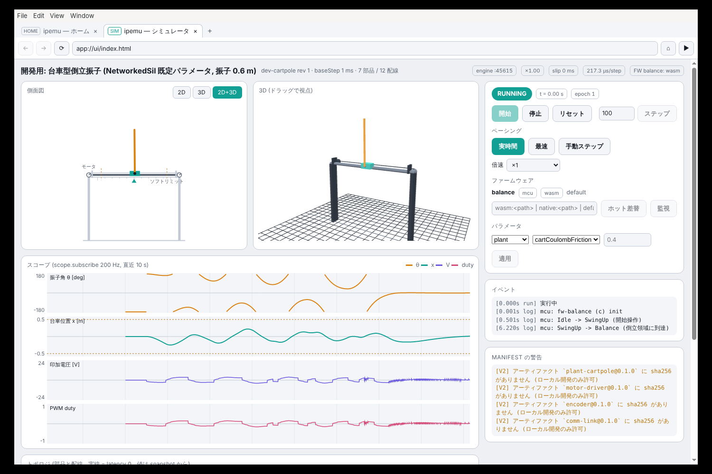
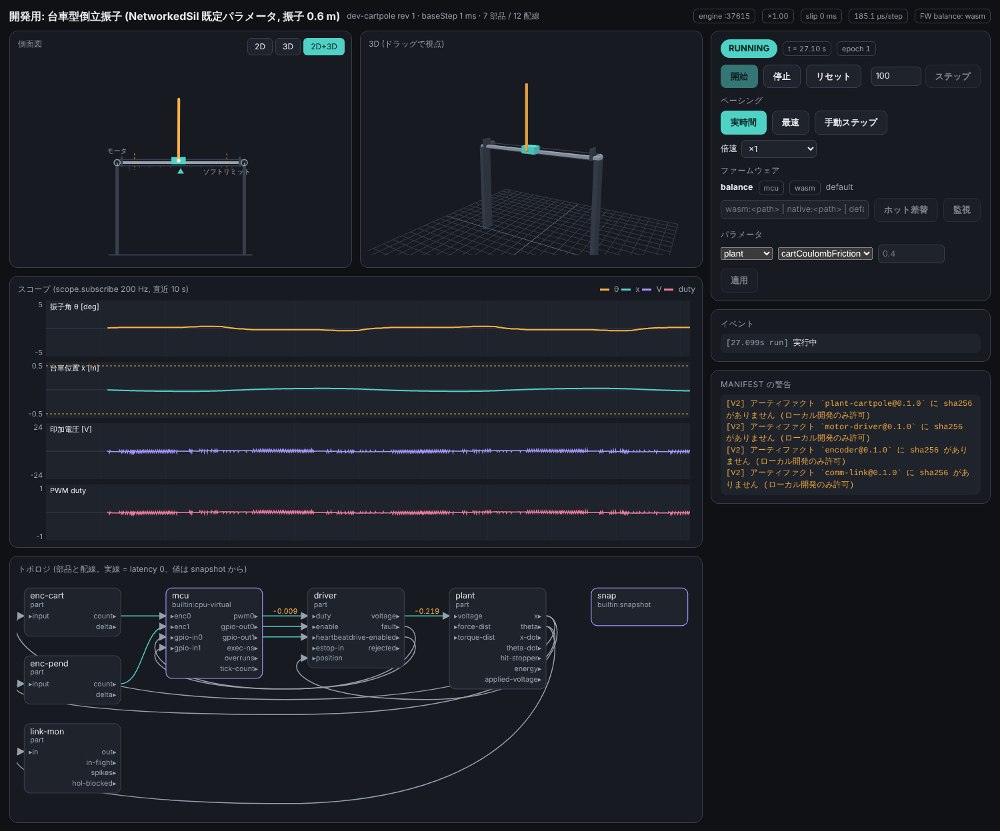

# 07. クライアントアプリ (Electron シェル + Rust エンジン)

## 2 つのプロセス
| プロセス | 技術 | 責務 |
| --- | --- | --- |
| シェル `apps/shell` | Electron (main: Node, renderer: Chromium) | **汎用ブラウザ** (タブ・アドレスバー・履歴)。信頼 origin へのブリッジ注入、`ipemu://` ハンドラ、シミュレータ UI の表示、同意ダイアログ、エンジンの起動と監視、`app://` プロトコル |
| エンジン `ipemu-engine` | Rust + Wasmtime + tokio | サーバとの通信、manifest 検証、組み立て、スケジューラ、capability の実施、IPC サーバ |

シェルはシミュレータの**状態を持ちません**。エンジンから受けたスナップショットを描き、操作をエンジンへ送るだけです。
これにより `ipemu-engine --headless` も、テストからの直接接続も、同じエンジンで動きます。
v1 で同時に動くセッションは 1 つで、別の構成を起動すると現在のセッションを停止して切り替えます
(複数化はエンジンを複数 spawn する拡張で、IPC 契約は変えません)。

## IPC 契約 (`crates/ipemu-ipc`)
```text
transport : ループバック WebSocket (127.0.0.1:<ephemeral>)。接続時にトークンを要求。
            ブラウザからの接続 (Origin ヘッダあり) は許可 origin (既定 app://ui、--allow-origin で追加) に一致しなければ
            トークンが正しくても 403 (トークン漏えい時に任意の Web ページが繋がる経路を塞ぐ多層防御)
discovery : エンジンが起動直後に stdout の 1 行目へ {"port": 54321, "token": "…"} を出す
            シェルが spawn したときは環境変数 IPEMU_IPC_TOKEN でも渡す
text frame: JSON-RPC 2.0  (要求 / 応答 / 通知)
bin  frame: MessagePack   (高頻度ストリーム。先頭 1 バイトでチャネル種別)
```

### 要求 (シェル / CLI → エンジン)
| メソッド | 内容 |
| --- | --- |
| `session.launch {server, manifestId, revision, credential}` | 構成の取得・検証・組み立て。実行中のセッションがあれば停止して置き換える |
| `session.describe` | 現在の manifest、部品一覧、ポート、capability と同意状態、上書きの有無、資格情報の種別 (利用者 / API キー) |
| `catalog.local` | キャッシュ済みの構成一覧 (ポータルに届かないときのローカルカタログ) |
| `run.start` / `run.stop` / `run.reset` / `run.step {n}` | 実行制御。`reset` は Epoch を進める |
| `run.setPacing {realtime\|fast\|step, speed}` | ペーシング変更 |
| `param.set {instance, key, value}` | 部品パラメータの変更 (部品が `init` で再作成されることを UI に明示) |
| `firmware.load {slot, source}` | ファームウェアの差し替え。`source` は `artifact:` / `wasm:` / `native:`。wasm はホット (状態保持)、native はエンジン再起動 (応答に `restartRequired: true`) |
| `firmware.watch {slot, path}` | ビルド成果物の更新を監視して自動で `firmware.load` |
| `scope.subscribe {ports[], rateHz, window}` | スコープ用ストリームの購読 |
| `consent.answer {requestId, grant, remember}` | 同意ダイアログの回答 (`ipemu_core::consent::ConsentAnswer`)。全件の回答が揃うまでエンジンは実体化しない |
| `manifest.refresh` | サーバへ再問い合わせ (手動更新) |

### 通知 (エンジン → シェル)
| 通知 | 内容 |
| --- | --- |
| `state` (bin, 50Hz 既定) | 仮想時刻、tick、ペーシング、`builtin:snapshot` に載せたポート値、実行時間 / オーバーラン、スリップ |
| `scope` (bin) | 購読したポートの高レート値 (リングバッファのチャンク) |
| `event` | 状態遷移、FAULT 理由、保護動作、ログ (レベル付き)、capability 使用 |
| `consent.required` | 未同意の capability の一覧。要素は `ipemu_core::consent::ConsentRequest` = `{requestId, instances[], artifact, artifactSha256, capability, reason, manifestId, revision}` (M5) |
| `bootstrap.progress` | manifest / artifact 取得の進捗、キャッシュ構成でのオフライン起動の通知 |

契約は `ipemu-ipc` に型として置き、TypeScript の型定義を `cargo` のビルドで生成します (`ts-rs` 等)。
シェルを Electron から別物に替えても、この契約だけを満たせばよい構造です。

## シェル (Electron)
```text
apps/shell/
  main/      ブラウザ UI: タブ / アドレスバー / 戻る進む / 履歴 / ダウンロード (任意のサイトを開ける)
             信頼 origin の判定: settings の trustedServers と、ページの origin を厳密比較
             ipemu:// プロトコルハンドラの登録 (初回起動) と受信 → 確認ダイアログ → session.launch
             エンジン spawn (同梱バイナリ。開発時は PATH / 環境変数で差し替え)、クラッシュ時の再起動と通知
             app:// プロトコル: エンジンのキャッシュにある UI バンドル (manifest の ui.bundle) を配信
             同意ダイアログ (OS ネイティブの dialog ではなく専用ウィンドウ。内容を偽装されにくくする)
  preload/   contextBridge。信頼 origin のページにだけ window.ipemu (launch / status / openSimulator) を注入する。
             それ以外の origin には何も注入しない (通常のブラウザとして振る舞う)
  renderer/  シミュレータ UI は配信された UI バンドル (app://)。React + ui-kit。sim-view は rAF で描画
```
- 全ページで `nodeIntegration: false`, `contextIsolation: true`, `sandbox: true`。renderer から Node は触れません。
- ブリッジ `window.ipemu` は **origin が `trustedServers` に一致するフレームにだけ**注入します (iframe・リダイレクト後も再判定)。
  信頼 origin は HTTPS 必須 (開発時のみ `http://localhost` を許す)。
- `app://` (シミュレータ UI) の CSP は `app://` と `ws://127.0.0.1` のみ許可。任意サイトのタブは通常のブラウザと同じ制約で、
  エンジンの IPC にも `app://` にも到達できません。
- `ipemu://launch?...` は外部 (Chrome / Edge / メール) からも届くため、**必ず確認ダイアログ**を出してから進みます。
  表示するのはサーバ origin・構成名・revision・要求 capability。信頼していないサーバからの起動は拒否します。
- UI バンドルはアーティファクトなので、manifest で**部品に合わせた UI を配れます** (`ui.views`)。
  UI バンドルの JS もエンジンのキャッシュ経由で sha256 検証済みです。

## エンジン (`crates/ipemu-engine`)
```text
ipemu-engine
  ├ settings   : <config dir>/ipemu/settings.toml  (trustedServers, apiKey (headless 用), cacheDir, telemetry = true)
  ├ bootstrap  : session.launch で受けた資格情報で manifest → 署名 → artifacts → キャッシュ (reqwest, rustls)
  │              資格情報は利用者のセッショントークン (シェル経由) / 単回チケットの交換 / API キーの 3 通り
  ├ firmware   : wasm はホット差替 (Store を入れ替え)、native は restartRequired を返してシェルに再起動させる
  ├ core       : ipemu-core (manifest 検証、配線グラフ、実行順、capability 判定)
  ├ wasm       : ipemu-wasm (Wasmtime Engine 1 つ、部品ごとに Store、WIT バインディング、WASI 付与)
  ├ firmware   : wasm ローダ / native ローダ (libloading)。cpu-virtual から呼ばれる
  ├ scheduler  : 専用スレッド。03-component-model.md のループ
  ├ ipc        : tokio + tungstenite。トークン認証。1 シェル + 複数の観測専用接続を許す
  └ telemetry  : 実行要約をバッチ送信 (settings で無効化可能)
```

### 対象プラットフォーム
Windows / macOS / Linux × x64 / arm64 の 6 通りをビルドします。Wasmtime (Cranelift) と Electron はいずれも対応済みで、
ファームウェアの native 形はホストと同じアーキでビルドします (Apple Silicon では arm64 の `.dylib`)。
wasm 形はアーキに依存しないため、配信物は 1 種類です。

### Wasmtime の設定
| 設定 | 値 | 理由 |
| --- | --- | --- |
| `wasm_component_model` | on | WIT 境界 |
| `cranelift_nan_canonicalization` | on | 決定性 |
| `epoch_interruption` | on (全部品) | 暴走した `step` を trap させる |
| `consume_fuel` | ファームウェア slot のみ | 実行時間モデル |
| `debug_info` | `--wasm-debug-info` のときのみ | LLDB からのソースデバッグ。性能が落ちるので既定 off |
| `cache` | on (キャッシュ dir 配下) | コンパイル結果の再利用で起動を速く |
| `wasm_threads` / `shared_memory` | off | 決定性と単純さ |

### capability の実施
| 宣言 | 実施 |
| --- | --- |
| `net.tcpConnect` | `wasi:sockets` を link し、`WasiCtxBuilder::socket_addr_check` で宛先を許可リストと照合。名前解決も許可ホストに限定 |
| `net.tcpListen` | 同上 (bind 可能なアドレスのみ) |
| `fs` | `preopened_dir` でデータディレクトリ配下の指定パスだけを、`mode` に応じた権限で開く |
| `clock` / `random` | `wasi:clocks` / `wasi:random` を link する。未宣言なら link しない |
| `hostExt.*` | `ip:emu/host-ext/<name>` を個別に link。各インターフェースはエンジン側で OS 資源に橋渡しし、使用回数を記録 |

**宣言のないものは import 自体を link しない**ので、実体化の時点で `unresolved import` として失敗し、
「承認なしに呼ばれる」経路がありません。これが WASI preview 2 を選んだ理由です。

既知の制約: 許可ホストの名前解決 (`NetAllow::resolve`) は `to_socket_addrs` を同期で呼ぶため、DNS の遅延がそのままスケジューラスレッドを止め、
仮想時間の進行も止まります (epoch interruption はホスト関数の中では効かない)。単一スレッド前提の設計上は許容とし、
M6 でタイムアウト付きの解決 (別スレッド + 期限) を検討します (監査 A7)。

### 同意 (consent)
```text
consent store: <data dir>/ipemu/consent.json
  key   : sha256(artifact) + ":" + capability 文字列 (例 "net.tcpConnect:192.168.10.5:502")
  value : { granted: bool, at, manifestId, revision, rememberUntil? }
```
- 実体化の前に未同意分をまとめてシェルへ問い合わせ、回答が揃うまで実行しません。
- 「今回だけ」「記憶する」「拒否」の 3 択。拒否された部品は実体化せず、構成全体を FAULT ではなく**起動不可**として表示します
  (部分的に動いた結果を信じないため)。
- headless 実行では `--consent-file` で事前同意を渡すか、未同意があれば非ゼロ終了します。

### 実装 (M5): capability の実施と同意
**実施 (`crates/ipemu-wasm/src/wasi.rs`)**
- `WasiGrant` (宣言をホスト側の実パスまで解決したもの) を `WasmPart::instantiate_with` / `WasmFirmware::load_with` に渡す。
  `ipemu_wasm::wasi::add_to_linker` が付与分だけを link し、`WasiState` (`WasiCtx` + `ResourceTable`) を Store データに同居させる。
  cpu-virtual の instance に書いた `capabilities` はそのファームウェアに適用する (native 形には適用しない。サンドボックス外)。
- link する範囲:

  | 宣言 | link するインターフェース (wasmtime-wasi 50, WASI 0.2.12, sync バインディング) |
  | --- | --- |
  | いずれかの WASI capability | `wasi:io/{error,poll,streams}` (土台) |
  | `net` | `wasi:sockets/{network,instance-network}` + 自前の `ip-name-lookup`。tcp 系の宣言で `tcp`, `tcp-create-socket`、`udp` で `udp`, `udp-create-socket` |
  | `fs` | `wasi:filesystem/{types,preopens}`。`preopened_dir(<data dir>/ipemu/data/<path>, "<path>", ro\|rw)` |
  | `clock` | `wasi:clocks/{wall-clock,monotonic-clock}` |
  | `random` | `wasi:random/{random,insecure,insecure-seed}` |
  | `hostExt: [serial-port]` | `ip:emu/serial-port` (M5 ではスタブ: `open` が Err を返す) |

  `wasi:cli/*` は決して link しない。stdio・環境変数・引数も与えない。
- ネットワークの許可判定 (`NetAllow`、`socket_addr_check`):
  - `TcpConnect` は `tcpConnect` の IP リテラルと一致するか、**許可ホスト名を解決して得た IP** でそのエントリのポートに一致するとき許可。
  - `TcpBind` は接続のための暗黙 bind (未指定アドレス:0) を `tcpConnect` があれば許可、明示 bind は `tcpListen` に従う。`TcpListen` も `tcpListen`。
  - `TcpAccept` の相手は宣言で縛れないので `tcpListen` があれば受け入れる。UDP は `udp` のリスト。
  - 名前解決は wasmtime-wasi のものを使わず、`wasi:sockets/ip-name-lookup` を自前で実装して**宣言にある名前だけ**解決する
    (それ以外は `access-denied`)。解決結果の IP を記録し、上の `TcpConnect` 判定に使う。
  - 拒否した宛先は `WasmPart::take_denied_destinations()` で取り出せる (将来 `event` 通知に載せる)。
- `fs` の閉じ込め: 宣言の文字列規則 (絶対パス・`..` 禁止) に加え、実体化時に canonical パスが `<data dir>/ipemu/data` 配下にあることを確認する。
  ゲスト側の `..` やシンボリックリンクは cap-std が preopen の外へ出さない。
- `clock` / `random` を付与した部品は `describe().deterministic` を自己申告によらず `false` にする (V10 と同じ判定)。
- manifest (宣言) がない文脈で describe() を読むには `WasmPart::describe_component_sandboxed(&Runtime, &[u8]) -> (PartDesc, Vec<ImportInfo>)`
  を使う (サーバの部品登録時、`inspect`)。import から `Capabilities::covering_imports` で必要な宣言を逆引きし、
  deny-all 形で link して実体化するので I/O は起きない。提供しない import (`wasi:cli` 等) があれば失敗する。
- 検証用部品 `components/tcp-reporter` (wasi:sockets + wasi:filesystem) と `crates/ipemu-wasm/tests/capability.rs` で、
  宣言なしの実体化失敗・許可リスト内 TCP の成功・許可外の拒否・名前解決の限定・preopen の境界 (`..` / 未宣言 / ro) を確認している。

**同意 (`crates/ipemu-engine/src/{capability,consent}.rs`)**
- `Session::load` は 2 パス: (1) wasm を読んで sha256 と import を取り、`CapabilityPlan` を立て、V7 を先に判定、
  (2) 同意が揃ってから `WasiGrant` を付けて実体化する。**同意の問い合わせは実体化より前**で、未同意・拒否があれば何も実体化しない。
- 同意ストア `<data dir>/ipemu/consent.json`:
  ```json
  { "version": 1, "entries": { "<sha256>:net.tcpConnect:192.168.10.5:502":
      { "granted": true, "at": "2026-11-05T09:00:00Z", "manifestId": "cartpole-lqr-default", "revision": 3, "rememberUntil": null } } }
  ```
  鍵は `ipemu_core::consent::consent_key(sha256, capability)`。書き込みは一時ファイル + rename。壊れたファイルは黙って捨てずエラーにする。
  記憶された拒否は、問い合わせずに起動不可にする (`ipemu-engine consent forget` で消せる)。
- 問い合わせの型 (IPC `consent.required` / `consent.answer` が運ぶ): `ipemu_core::consent::{ConsentRequest, ConsentAnswer}`。
  `requestId` は同意ストアの鍵と同じ文字列で、同じ (artifact, capability) を複数 instance が使う場合は 1 件にまとめて `instances` に併記する。
- エンジン側のインターフェースは `ipemu_engine::ConsentProvider` (`ask(&[ConsentRequest]) -> Vec<ConsentAnswer>`)。
  回答のない request は「未同意」のまま残る。M2 のシェルはこれを IPC で実装する。headless の実装:
  - `--consent-file <json>` (`FileConsent`): `{"version":1,"grants":["<sha256>:<cap>", "*:<cap>"],"denies":[…],"remember":false}`。
    `*:` はアーティファクトを問わない開発用の指定で、**ローカル開発モード (`--no-signature-check` = `allow_unhashed`) のときだけ受理**し、
    それ以外はエラーにする (配布用の設定で使えないことを実装で担保)。`remember: true` なら許可をストアにも書く。
    鍵の照合で大文字小文字を区別しないのは `<sha256>` 部分だけで、capability 文字列 (`fs:rw:<path>` のパスなど) はそのまま比べる (D56)。
  - 指定なし (`NoConsent`): 未同意があれば終了コード **3**、拒否があれば **4** で非ゼロ終了 (`LaunchError`)。
  - `validate` / `inspect` は実行しないので同意を求めず、**deny-all 形** (`WasiGrant::deny_all_for`) で実体化する:
    宣言と同じインターフェースは link されるので describe / init は通るが、接続・名前解決・ファイル操作はすべて拒否され、
    データディレクトリにも触れない (D34)。
- データディレクトリは `--data-dir` > `IPEMU_DATA_DIR` > OS 既定 (Linux `$XDG_DATA_HOME`/`~/.local/share`、macOS `~/Library/Application Support`、Windows `%APPDATA%`)。
- CLI: `ipemu-engine consent list --manifest … [--json]` (同意が要る鍵の列挙と `--consent-file` の雛形)、`consent show`、`consent forget <key>… | --all`。
  `ipemu-engine inspect <wasm>` は describe に加えて import 一覧と、それを動かすのに最低限要る宣言の目安を出す。

## テレメトリ
既定で on です。送るのは実行要約 (開始 / 終了 / FAULT 理由 / オーバーラン数 / 時間スリップ / capability 使用回数 / エンジン版・OS・アーキ) だけで、
信号の生値・パラメータ・ファームウェアの内容は送りません。`settings.toml` の `telemetry = false` で止まり、
UI の「このセッション」画面に送信の有無と直近の送信内容を表示します。

## キャッシュとオフライン
```text
<cache dir>/ipemu/
  sha256/ab/cd/<hex>            アーティファクト本体 (イミュータブル)
  manifests/<server>/<id>/<revision>.json 署名付き manifest (複数の構成を保持)
  catalog.json                   キャッシュ済み構成の一覧 (ローカルカタログ) と最終起動日時
  wasmtime/                      コンパイルキャッシュ
```
- `<id>` はパスに入るので、`BootstrapOptions::new` / `bootstrap()` の入口と `Cache` の manifest 系メソッドで
  スキーマと同じ `^[a-z0-9][a-z0-9-]{2,63}$` (`ipemu_core::manifest::is_valid_manifest_id`) に適合するか確かめ、不正ならエラーにする (D55)。
  `--launch` や `ipemu://` の値をそのまま渡しても、`../` でキャッシュの外を指せない。
- サーバに届かないときは、ローカルカタログから選んだ構成の manifest と参照アーティファクトが揃っていれば起動します。
- GC は「直近 N 回起動した構成から参照されるもの」以外を、サイズ上限超過時に LRU で削除します。

## 開発者向け CLI
```bash
ipemu-engine --headless --manifest dev/cartpole.manifest.json --no-signature-check \
             --firmware balance=wasm:target/wasm32-wasip2/release/fw_balance.wasm \
             --run-seconds 10 --record out.csv --pacing fast
ipemu-engine --headless --server https://ipemu.example --api-key "$IPEMU_API_KEY" \
             --launch cartpole-lqr-default@3 --run-seconds 60     # API キーでカタログの構成を起動
ipemu-engine --watch balance=wasm:target/wasm32-wasip2/debug/fw_balance.wasm   # 再ビルドで自動ホット差替
ipemu-engine validate dev/cartpole.manifest.json        # サーバと同じ検証をローカルで
ipemu-engine inspect components/plant-cartpole.wasm     # WIT / describe の表示
ipemu attach --port 54321                               # 動作中のエンジンの state を端末に流す
```

## 実装 (M2)
M2 で実装した範囲と、設計からの具体化。サーバ配信 (bootstrap / キャッシュ / telemetry) は M3、capability の実施と同意の中身は M5。

### 契約 `crates/ipemu-ipc`
- 上の表の全メソッド / 通知を Rust の型にし、`RequestBody` (`method` タグ + `params`) と `ResultBody` (同じタグで result 型) の
  2 つの enum で「method → (params, result)」を TypeScript に伝える。`cargo test -p ipemu-ipc` (= `scripts/gen-ipc-types.sh`) が
  ts-rs で `crates/ipemu-ipc/bindings/*.ts` を書き出し、pnpm workspace の `@ipemu/ipc-types` として `apps/` が使う。
  生成物はコミットし、`check.sh` が `--check` で差分を検出する。
- i64 / u64 は TS の `number` (仮想時刻 ns で 2^53 まで足りる。bigint は JSON / msgpack と相性が悪い)。
- バイナリフレームは先頭 1 バイト (0x01 = state, 0x02 = scope) + MessagePack (名前付きフィールド)。TS 側は `@msgpack/msgpack`。
- `session.launch` の `source` は `{kind: "local", manifestPath}` (開発) と `{kind: "server", server, manifestId, revision?, credential?, offline}` の 2 形。
  `server` は M3 の `bootstrap` (取得 → 署名検証 → キャッシュ) を通してから同じ `Session::load` に渡す。`credential` は
  `sessionToken` / `ticket` / `apiKey` の 3 種で、`offline: true` (ローカルカタログからの起動) のときだけ省略できる。
  `catalog.local` は bootstrap のキャッシュにある構成も (`offline: true` の source で) 列挙する。
- `consent.required` の本文は `ipemu_core::consent::ConsentRequest` と同形 (`instances[]`, `artifact`, `artifactSha256`, …)。
  `consent.answer` は `ConsentAnswer` と同形。
- エラーコード: 標準 4 つ + `-32000 ENGINE_ERROR` / `-32001 NO_SESSION` / `-32002 RESTART_REQUIRED` / `-32003 NOT_IMPLEMENTED` /
  `-32004 UNAUTHORIZED` / `-32005 NOT_FOUND` / `-32006 INVALID_STATE`。

### エンジン `crates/ipemu-engine` (`serve` / `attach`)
```text
ipemu-engine serve [--manifest … --no-signature-check --firmware slot=wasm:… --param i.k=v --pacing realtime|fast|step
                    --speed 1 --auto-start --watch slot=wasm:… --debug-friendly --catalog-dir dev --port 0 --token …
                    --state-hz 50 --exit-on-stdin-close]
  stdout 1 行目: {"port":…,"token":…,"pid":…,"ipcVersion":1,"engineVersion":"0.1.0"}。以降 stdout には何も出さない
ipemu-engine attach --port … [--token …] [--send run.start] [--every 0.5] [--seconds 10]
```
| モジュール | 役割 |
| --- | --- |
| `control.rs` | **スケジューラ専用スレッド**上の制御器。IPC からの要求は `std::sync::mpsc` に積まれ、ステップ境界でだけ状態を変える。`run.*`、`param.set` (wasm 部品は `init` し直し、組み込み部品は `restartRequired`)、`firmware.load` (wasm = `CpuVirtual::attach_firmware` でホット、native = 上書きを記録して `restartRequired: true`)、`firmware.watch` (mtime 監視、更新 200ms 後に自動差替)、`scope.subscribe` (ステップごとに採り、`windowS` ぶんまとめて scope フレーム)、`catalog.local` (`--catalog-dir` の `*.manifest.json` + bootstrap キャッシュの構成)、`manifest.refresh` (ローカルは再検証して差分報告、サーバは取得し直して revision / 本文の差分を報告)。`source.kind = "server"` の launch は `bootstrap` を経由し、`describe().offline` にキャッシュ起動かを載せ、telemetry (started / stopped / error) を送る |
| `pacing.rs` | realtime の追いつき (壁時計 × speed との差ぶんステップ)、`maxSlipMs` 超過で原点を取り直す**時間スリップ**、`--debug-friendly` (デバッガ検出でも) は追いつかない。`SchedulerStats` (倍率 / µs/step / スリップ / 予算超過) を state に同梱 |
| `triple_buffer.rs` | スケジューラ → tokio のスナップショット受け渡し。書き手は待たない |
| `ipc_server.rs` | `127.0.0.1:0` の WebSocket (tokio-tungstenite)。`?token=` か `Authorization: Bearer` を**ハンドシェイクで**照合 (不一致は 401)。`Origin` ヘッダがあれば許可リスト (既定 `app://ui`、`--allow-origin`) と厳密一致しなければ 403 (Origin の無い CLI / シェル main はトークンのみ)。state は `state_hz` でトリプルバッファを読んで全接続へ broadcast、通知 / scope は到着順。遅い受け手は古いフレームを落とす。`client` モジュールはテストと `attach` 用 |
| `session.rs` | M1 の `Session` に `swap_firmware` / `set_param` / `step` / `reset` と `options` (上書きの元) を追加。`ipemu-core` の `Part` に `as_any_mut` (既定 `None`) を足して cpu-virtual へ降りる。ホット差替は M5 の 2 パス構造に乗せ、宣言と import の整合 (V7) を確認し、**差し替え先の sha256 で同意を取り直してから** (同じビルドなら聞かない) grant を付与する。未同意・拒否なら古いファームウェアを残す (D49) |
| `consent_ipc.rs` | `ConsentBroker`: M5 の `ConsentProvider` を IPC で実装。`consent.required` を流し、`consent.answer` を Condvar で待つ |

`debug-friendly` では wasm 呼び出しの予算 (`call_budget`) も無制限にする (ブレーク中に epoch で trap させない)。
結合テスト (`crates/ipemu-engine/tests/ipc.rs`): 認証 (トークン / Origin)、describe、`run.start` → state 受信、**C 版 → Rust 版の wasm ホット差替で
仮想時刻・Epoch・プラント状態が保たれ、新しい FW が倒立を引き継ぐ**、native は `restartRequired`、`param.set`、scope、実バイナリの serve、
同意の IPC 往復 (拒否で起動しない / 許可で起動 / ホット差替は新しい sha256 で再同意)。
`tests/ipc_server_launch.rs`: in-process のサーバに公開した構成を `source.kind = "server"` + API キーで取得して倒立、
`catalog.local` にキャッシュ済み構成が載り、サーバ停止後に `offline: true` で再起動できる (`describe().offline`)。

### シェル `apps/shell` (Electron 45)
設計の節のとおり。要点と具体化:
- タブは `BaseWindow` + `WebContentsView`。タブの種類 `web` (任意サイト, preload = bridge) / `sim` (`app://ui/` 固定, preload = simui) /
  `home` (`app://shell/`, preload = shellui) で **preload と遷移できる範囲を固定**する。任意サイトのタブは `app://` に遷移できず、
  `window.open` も web タブとして開く。権限要求 (カメラ等) は一律拒否。
- ブリッジの注入可否は preload が main に同期で問い合わせ、main は **`event.senderFrame.url` の origin** を `trustedServers` と
  厳密比較する (renderer の申告は使わない)。`ipemu:*` の各 IPC も同じ検査を通す。`launch` の `server` はページ自身の origin に限る。
- `app://` は `protocol.handle` で配信。`app://ui/` の CSP は `default-src 'self'; connect-src 'self' ws://127.0.0.1:*` など、
  `app://shell/` は `'self'` のみ。UI バンドルは **単一ファイルの tar.gz** (manifest の `ui.bundle`、`kind: "ui"`) を
  `<userData>/ui-cache/<sha256>/` に展開して配信する (`untar.ts`: 絶対パス / `..` / リンクを拒否。manifest に sha256 があれば照合)。
- `ipemu://launch?…` は `parseLaunchUrl` で厳格に解析し、**必ず確認ウィンドウ** (`confirm.html`、OS の dialog ではない) を出す。
  信頼していないサーバは理由を表示して「起動する」を無効にする。開発用に `manifestPath=` (`allowLocalLaunch`) も受ける。`window.ipemu.launch` の `manifestPath` も同じ設定で縛る (既定は拒否。監査 M2-1)。
  OS への登録は packaged 時のみ。
- エンジンは `serve --exit-on-stdin-close --catalog-dir …` で spawn し、stdout 1 行目を読んで接続。`restartRequired` (native FW) では
  直近の describe の `overrides` を launch に畳み込んで **同じ構成で spawn し直し**、`app://ui` のページに `endpoint-changed` を送る。
- 同意ウィンドウ (`consent.html`) は `consent.required` 通知で開き、`consent.answer` を返す。エンジン側は `ConsentBroker`
  (`crates/ipemu-engine/src/consent_ipc.rs`) が M5 の `ConsentProvider` を IPC で実装する: `Session::load` がスケジューラスレッド上で
  `ask` を呼ぶと未同意分を通知し、回答が揃うまで待つ。`consent.answer` は制御器を経由せず IPC サーバから直接ブローカへ届く (D48)。
  `--consent-file` を渡した `serve` はダイアログを出さずファイルで答える (headless)。

### UI `apps/ui-kit` / `apps/sim-ui`
- `ui-kit`: `EngineClient` (JSON-RPC + msgpack、生成型で `call("run.step", {n})` が型付け)、`sim-view.js` の移植
  (側面図 / three.js を npm で同梱した 3D / スコープ)、トポロジ図 (latency 0 の配線で層を分け、snapshot の値を配線に添える)、
  操作パネル (開始 / 停止 / リセット / ステップ / ペーシング / パラメータ / FW 差替と監視)、イベント一覧。
  state は 50Hz で来るので React には 5Hz に間引いて渡し、canvas は rAF で `store.latest` を読む。
- `sim-ui`: UI バンドル本体。接続先は `window.ipemuEngine` (シェル) → `?port=&token=` → 入力。`scope.subscribe` で
  θ / x / V / duty を 200 Hz で購読。`vite build` → `build/ui/cartpole/`、`scripts/pack.mjs` → `build/ui/ui-cartpole.tar.gz`。
  `dev/cartpole.manifest.json` の `ui.bundle` がこれを指す。

### 動作確認
```bash
cargo build -p ipemu-engine && pnpm install && pnpm --filter @ipemu/sim-ui build
pnpm --filter @ipemu/shell start           # Electron シェル (ホーム → ローカルカタログ → 組み立てる)
# Electron なしの開発: エンジン + Vite dev server + ブラウザ
cargo run -p ipemu-engine -- serve --manifest dev/cartpole.manifest.json --no-signature-check --pacing realtime --auto-start
#   ブラウザからつなぐときは Origin 検査に通すため --allow-origin http://localhost:5173 を足す
pnpm dev:ui     # http://localhost:5173/?port=<port>&token=<token>
```


