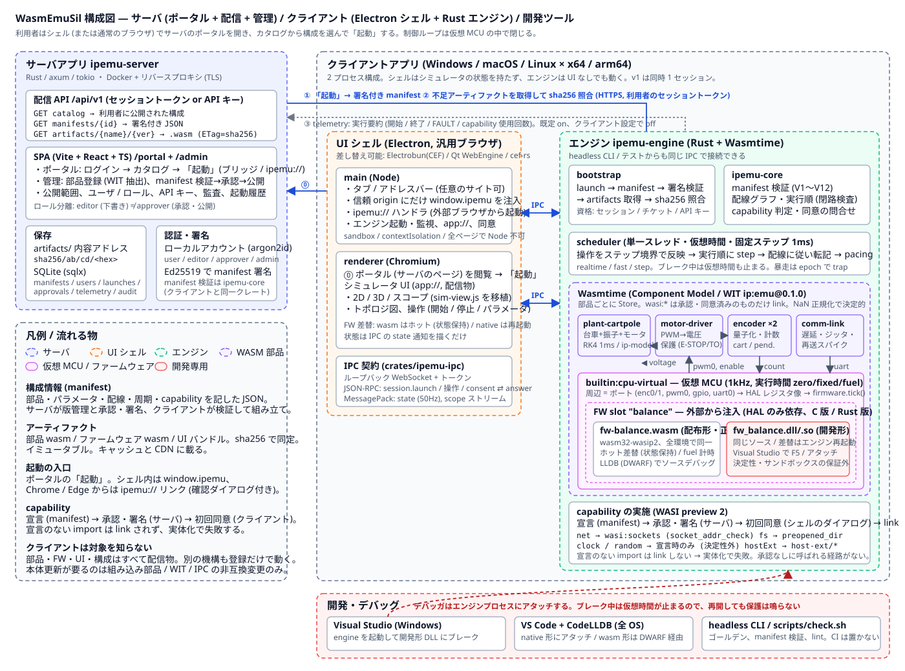

# WasmEmuSil — WASM 部品で組む倒立振子エミュレータ (設計草案)

> **状態: 設計中 (実装未着手)。** 本ディレクトリには動くコードはまだありません。
> 設計ドキュメント ([`Docs/`](Docs/README.md))、構成情報のスキーマ ([`schemas/`](schemas/))、
> 部品 / ファームウェアのインターフェース草案 ([`abi/`](abi/)) を先に固め、承認後に実装へ入ります。

[`../NetworkedSil`](../NetworkedSil/README.md) と同じ台車型倒立振子を、
**クライアント側で組み立てるエミュレータ**として実現します。

- **サーバアプリ**: アクセスすると構成情報 (manifest) と部品 (WASM) をダウンロードできる配信サーバ + 管理画面
- **クライアントアプリ**: Chromium (UI シェル) + Wasmtime (エミュレータエンジン) のデスクトップアプリ。Windows / macOS / Linux。
  起動時にサーバから構成情報を取り、構成に書かれた部品 WASM を取り寄せてエミュレータ環境を組み立てる
- **仮想 MCU**: エミュレータの中の CPU 部品。その中で走る**制御プログラム (ファームウェア) は外部から注入**する。
  配布形は WASM (全 OS 共通)。同じ C / Rust ソースをネイティブ共有ライブラリにもビルドでき、
  Windows では Visual Studio で F5 / アタッチしてブレークポイントを置ける
- **許可制の OS アクセス**: 部品やファームウェアが TCP・ファイル・OS 機能を使う場合は、
  manifest で宣言 → 管理者が承認・署名 → クライアントで利用者が初回に同意、の 3 段を通る



## 何が変わるか (NetworkedSil との違い)
| 観点 | NetworkedSil | WasmEmuSil |
| --- | --- | --- |
| 制御ループの場所 | バックエンド。通信路がループの内側 | クライアント内の仮想 MCU。通信路はループの外側 |
| サーバの役割 | コントローラそのもの | 構成情報と部品の配信・管理 |
| 時間 | 実時間 (ブラウザの Stopwatch とサーバの時計) | **仮想時間**。固定ステップで決定的。実時間へのペーシングは任意 |
| 制御プログラム | C# (`ControllerCore`) がサーバに固定 | C / Rust ソースを WASM (配布) とネイティブ (デバッグ) にビルドして注入 |
| デバッグ | ブレークで止めるとウォッチドッグが鳴る | ブレークで止めると**仮想世界ごと止まる**。再開しても矛盾しない |
| 部品の差し替え | ソース変更と再デプロイ | 構成情報の編集と部品 WASM の登録。クライアントは再起動のみ |
| 実装言語 | C# (.NET 10) | エンジン / サーバ / 部品: Rust、UI: TypeScript、ファームウェア: C / C++ / Rust |

## ドキュメント
| ドキュメント | 内容 |
| --- | --- |
| [Docs/01-concept.md](Docs/01-concept.md) | 目的、設計原則、NetworkedSil からの位置づけ、スコープ外 |
| [Docs/02-architecture.md](Docs/02-architecture.md) | 全体構成 (構成図)、起動シーケンス、プロセス / スレッドモデル、仮想時間 |
| [Docs/03-component-model.md](Docs/03-component-model.md) | 部品のインターフェース (WIT)、ポートと配線、スケジューラ、決定性 |
| [Docs/04-manifest.md](Docs/04-manifest.md) | 構成情報 (manifest) の仕様、検証規則、版と署名、capability 宣言 |
| [Docs/05-firmware.md](Docs/05-firmware.md) | 仮想 MCU と HAL、WASM / ネイティブの 2 形、Visual Studio / LLDB でのデバッグ |
| [Docs/06-server-app.md](Docs/06-server-app.md) | 配信 API、管理画面、保存、認証・署名・承認フロー |
| [Docs/07-client-app.md](Docs/07-client-app.md) | Electron シェル、Rust エンジン、IPC 契約、capability の実施、キャッシュとオフライン |
| [Docs/08-decisions.md](Docs/08-decisions.md) | 技術選定の比較 (トレードオフ)、未決事項、マイルストーン |
| [Docs/09-verification.md](Docs/09-verification.md) | 検証方針: 性質テスト、ゴールデントレース、決定性、適合性テスト |
| [schemas/emulator-manifest.schema.json](schemas/emulator-manifest.schema.json) | 構成情報の JSON Schema と [サンプル](schemas/examples/cartpole-lqr.manifest.json) |
| [abi/wit/](abi/wit/) / [abi/ip_hal.h](abi/ip_hal.h) | 部品・ファームウェアの WIT 定義と、ネイティブ形用の C ヘッダ草案 |

## 予定しているディレクトリ構成
```text
WasmEmuSil/
  Cargo.toml                    ワークスペース (エンジン / サーバ / 部品 / 共有クレート)
  package.json                  pnpm ワークスペース (Electron シェル / 管理 SPA / 共有 UI)
  abi/wit/                      ip:emu パッケージの WIT (部品・ファームウェア・ホスト拡張)
  abi/ip_hal.h                  ファームウェア HAL の C ヘッダ (wasm / native 共通)
  schemas/                      manifest の JSON Schema とサンプル
  crates/
    ipemu-core/                 manifest 解釈、配線グラフ、スケジューラ、capability 判定 (サーバと共有)
    ipemu-wasm/                 Wasmtime ホスティング、部品 / ファームウェアのローダ、WASI 付与
    ipemu-ipc/                  シェル ⇄ エンジンの IPC 契約 (JSON-RPC + MessagePack)
    ipemu-engine/               クライアントのエンジン実行ファイル (headless CLI も兼ねる)
    ipemu-server/               配信 API + 管理 SPA の配信 (axum)
    ip-model/                   台車+振子+DC モータの物理モデル (no_std、部品とテストで共有)
  components/                   部品 (cargo component → .wasm)
    plant-cartpole/  motor-driver/  encoder/  comm-link/
  firmware/
    fw-balance/                 C: 状態機械 + LQR + スイングアップ。wasm と native の両方にビルド
  apps/
    shell/                      Electron シェル (main / preload / renderer)
    admin/                      管理 SPA (Vite + React)
    ui-kit/                     共有 UI (sim-view の移植、スコープ、トポロジ表示)
  tests/                        結合テスト、ゴールデントレース、適合性テスト
  Docs/
```
